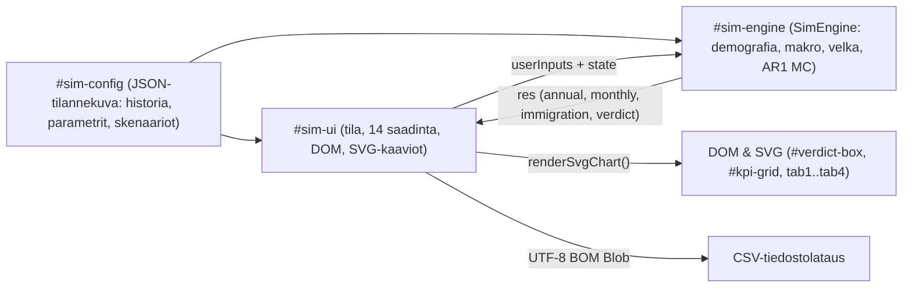

# SuomiSimulaattori (`suomi_simulator.html`)

> [!WARNING]
> **Vastuuvapauslauseke / Disclaimer:** Tämä sovellus on **100 % vibekoodattu Gemini 3.8 Flash High -mallilla**, eikä esitettyjen lukujen, historiallisten poimintojen, parametrien tai ennusteiden oikeellisuudesta anneta **mitään takuita**. Sovellus on tarkoitettu ainoastaan havainnollistavaan ja kokeelliseen tarkasteluun, eikä sitä tule käyttää virallisen päätöksenteon tai taloudellisen neuvonnan perustana.

👉 **[Avaa SuomiSimulaattori suoraan selaimessa](https://markorastas.github.io/SuomiSimulaattori/)** *(suora tiedostolinkki: https://markorastas.github.io/SuomiSimulaattori/suomi_simulator.html)*

**SuomiSimulaattori** ([`suomi_simulator.html`](suomi_simulator.html)) on täysin itsenäinen, yhden HTML-tiedoston kokoinen selainpohjainen Suomen julkisen talouden simulointityökalu. Se yhdistää tiedostoon upotetun vuosien 2019–2025 tilastohistorian sekä vuoteen 2050 ulottuvan deterministisen ja 800 kierroksen Monte Carlo -ennustemallin ilman ulkoisia kirjastoja, palvelimia tai asennuksia.

**Lisenssi:** Koodi **MIT** ([`LICENSE`](LICENSE)), dokumentaatio & tilastolähteet **CC BY 4.0** — © 2026 **Marko Rastas** (katso tarkemmat ehdot ja mainintaohje alta [Osa 4](#osa-4-lisenssit-tekijänoikeudet-ja-tietolähteet)).

### Pikakäyttö
* **Suoraan verkossa:** Klikkaa yllä olevaa linkkiä ([Avaa SuomiSimulaattori suoraan selaimessa](https://markorastas.github.io/SuomiSimulaattori/)) — toimii suoraan sekä tietokoneella että puhelimessa (Android & iPhone).
* **Paikallisesti tietokoneella:** Lataa [`suomi_simulator.html`](suomi_simulator.html) ja avaa se kaksoisklikkaamalla missä tahansa selaimessa (toimii myös ilman nettiyhteyttä).
* **Paikallisen tiedoston jako puhelimeen (esim. WhatsApp):** Androidissa napauta tiedostoa ja valitse **Chrome**; iPhonessa WhatsAppin sisäinen esikatselu estää JavaScriptin (näkyy keltainen varoituspalkki), joten valitse **Jaa (`⍐`) → Avaa Safarissa**.

---

## Osa 1: Sovelluksen rakenne ja selainarkkitehtuuri

Koko sovellus sijaitsee yhdessä tiedostossa ([`suomi_simulator.html`](suomi_simulator.html), `1 650` riviä), joka jakautuu neljään selkeään kerrokseen: CSS-ulkoasuun, HTML-runkoon, upotettuun JSON-tietorakenteeseen (`#sim-config`) sekä kahteen IIFE-suojattuun JavaScript-moduuliin (`#sim-engine` ja `#sim-ui`).

### 1.1 CSS-suunnittelujärjestelmä ja responsiivisuus
* **Väritokenit (`:root`):** Vaalea pintateema määrittää muuttujat `--bg` (`#f8fafc`), `--surface` (`#ffffff`), `--surface-2` (`#f1f5f9`), `--text` (`#0f172a`), `--muted` (`#475569`), `--border` (`#e2e8f0`) sekä merkitysvärit `--green` (`#16a34a`), `--red` (`#dc2626`), `--blue` (`#2563eb`), `--purple` (`#6d28d9`) ja `--amber` (`#d97706`).
* **Työpöytä- vs. mobiiliasettelu:** Työpöydällä `.layout` näyttää vasemmassa reunassa pysyvän `340 px` leveän ohjauspaneelin (`.sidebar { position: sticky; max-height: 100vh }`) ja oikealla enintään `1360 px` leveän sisältöalueen (`.main`). Alle `960 px` näytöillä (`@media (max-width: 960px)`) sivupalkki piilotetaan oletuksena (`display: none`) ja avataan yläreunan `#mobile-toggle`-painikkeella (`.sidebar.open`), ja monipalstaiset ruudukot (`.kpi-grid`, `.grid-2`) pinotaan yksipalstaisiksi (`1fr`).
* **Kosketusselauksen suojaus:** SVG-kuvaajakontti `.svg-wrap` asettaa `touch-action: pan-y`, jolloin pystysuora sormivieritys puhelimella ei lukitu kaavion kohdistinliikkeisiin.
* **Esikatselutunnistin (`#no-js-banner`):** Sivun ylin keltainen huomautuspalkki on näkyvissä staattisessa HTML:ssä ja piilotetaan heti `#sim-ui`-skriptin alussa (`banner.style.display = "none"`). Jos vastaanottaja avaa tiedoston ympäristössä, jossa JavaScript on estetty (kuten iOS:n QuickLook), ohjepalkki jää näkyviin.

### 1.2 DOM-rakenne
* **Ohjauspaneeli (`<aside id="sidebar">`):** Aikaresoluution vaihto (`Vuositaso` / `Kuukausitaso`), kausivaihtelun kytkin, skenaariovalikko sekä 14 liukusäädintä kolmessa ryhmässä.
* **Tulosnäkymä (`<main>`):**
  * `#mobile-toggle`: Ohjauspaneelin avauspainike kapeilla näytöillä.
  * `#app-subtitle`: Historiatiedon lähdekuvaus, Monte Carlo -ajojen määrä ja selaimen suoritusaika millisekunteina.
  * `#verdict-box`: Dynaamisen värikoodin (`.kestava`, `.naivettyminen`, `.velkakriisi`) saava yhteenvetokortti.
  * `#kpi-grid`: Kolmen ajankohdan vertailuruudukko (`2025 Toteutunut`, `2035 Ennuste mediaani`, `2050 Ennuste mediaani`), joista jokaisessa näytetään tulot, menot, rahoitusjäämä, julkinen velka sekä demografinen ja taloudellinen huoltosuhde.
  * **Neljän välilehden navigointi (`.tabs`):**
    * `#tab1` (*Pääkäyrät*): Tulot, menot ja rahoitusjäämä joko yhtenäisenä tai jaettuna näkymänä sekä erillinen ylijäämä-/alijäämäpylväikkö (`p5–p95` luottamusvyöhykkeillä).
    * `#tab2` (*Erittely & maahanmuutto*): Pinottu menojen rakenne (6 erää), pinottu tulojen rakenne (4 erää), maahanmuuttoryhmien vuotuinen nettokassavirta 2026–2050 sekä vuosikohtainen (`2026–2050` liukusäätimellä) ryhmävertailu.
    * `#tab3` (*Velka, väestö & data*): Velkasuhteen kehitys raja-arvoineen (`60 %`, `90 %`, `100 %`, `120 %`), korkomenojen tulo-osuus ja velan keskikorko (`8 %` ja `15 %`), väestörakenteen ikäryhmäpinokuvaaja, vieritettävä lukutaulukko ja UTF-8 BOM -muotoinen CSV-lataus.
    * `#tab4` (*Metodologia*): Upotetun tilastodatan tila, aikaleima, mallioletukset ja mobiilikäyttöohjeet.

### 1.3 Upotettu tietokanta (`<script id="sim-config" type="application/json">`)

Konfiguraatio sisältää kaiken laskennan lähtödatan ilman ulkoisia kutsuja:

| Avain | Tyyppi | Rooli ja sisältö |
| :--- | :--- | :--- |
| `hist` | `Array<Object>` | Vuosien `2019–2025` (7 vuotta) toteutuneet tilasto- ja väestötietueet (StatFin `122g`, `15ah`, `15a9`, `11rs`, `13aj` ja THL Sotkanet `ind. 761`). |
| `params` | `Object` | Mallin `50` rakenteellista kalibrointi- ja Monte Carlo -parametria (katso taulukko alla). |
| `presets` | `Object` | Neljä valmista makrotaloudellista skenaariopohjaa (`Perusskenaario`, `Korkea työperäinen kasvu`, `Korkea humanitaarinen maahanmuutto`, `Tiukka menokuri`). |
| `forecastYears` | `Array<number>` | Ennustevuosivektori `[2026, 2027, ..., 2050]` ($T = 25$). |
| `subgroups2025` | `Object` | Vieraskielisen/ulkomaalaistaustaisen `18–64 v` lähtökannan jakauma vuonna 2025: `work_immigrants` (`248 000`), `humanitarian_immigrants` (`187 000`), `student_immigrants` (`42 643`). |
| `humCurve` | `Array<number>` | 11-portainen humanitaarisen ryhmän työllisyyskäyrä maassaoloajan $k = 0, \dots, 10+$ mukaan: `[0.14, 0.24, 0.33, 0.40, 0.45, 0.49, 0.52, 0.55, 0.57, 0.59, 0.61]`. |
| `humTenureShares` | `Array<number>` | Vuoden 2025 humanitaarisen kannan jakautuminen maassaolokohortteihin (`11` osuutta välillä `0.045–0.295`, summa `1.0`). |
| `youthProfile` | `Array<number>` | `18` ikäluokan (`0–17 v`) lähtöprofiili skaalattavaksi vuoden 2025 `pop_0_17`-määrään. |
| `revSeasonal` | `Array<number>` | `12` kuukauden kausipainot verotuloille (`tammikuu = 1.03`, ..., `joulukuu = 1.06`, keskiarvo `1.0`). |
| `expSeasonal` | `Array<number>` | `12` kuukauden kausipainot julkisille menoille (`kesäkuu = 1.08` lomarahat, `joulukuu = 1.11`, keskiarvo `1.0`). |
| `sourceStatus` | `Object` | Tilastolähteiden tilamerkinnät tiedoston luontihetkellä. |
| `updatedAt` | `string` | Upotetun tilannekuvan aikaleima (`"2026-11-10 18:19:41 UTC"`). |

#### Vuoden 2025 historialliset lähtöarvot (`hist` viimeinen rivi)
Julkisyhteisöjen tulot `151,221 mrd. €`, menot `161,966 mrd. €`, alijäämä `-10,745 mrd. €` (`-3,81 %` BKT:sta), nimellinen BKT `281,783 mrd. €`, EDP-velka `249,225 mrd. €` (`88,45 %` BKT:sta), korkomenot `4,559 mrd. €` (`3,01 %` tuloista), väkiluku `5 652 881` (`pop_0_17 = 1 004 036`, `pop_18_64 = 3 301 351` joista suomalaistaustaisia `2 823 708` ja ulkomaalaistaustaisia `477 643`, `pop_65_74 = 672 046`, `pop_75_plus = 675 448`), työlliset `15–74 v` `2 590 000`.

#### `params`-oletusarvot (`50` parametria)
* **Työmarkkinat & palkat:** `inflation_rate = 0.02`, `native_base_employment_rate = 0.74`, `work_imm_employment_rate = 0.82`, `student_employment_rate = 0.45`, `elderly_65_74_employment_rate = 0.13`, keskipalkat `native_avg_wage_eur = 46 000`, `work_imm_avg_wage_eur = 44 500`, `humanitarian_avg_wage_eur = 33 000`, `student_avg_wage_eur = 22 000`, `elderly_65_74_avg_wage_eur = 32 000`.
* **Veroparametrit:** `effective_wage_tax_soc_rate = 0.56`, `pension_income_tax_rate = 0.225`, `net_disposable_wage_share = 0.70`, `consumption_tax_rate = 0.215`, `autonomous_indirect_tax_gdp_share = 0.0445`, `social_clawback_rate = 0.18`, `corp_capital_property_gdp_share = 0.1413`.
* **Sosiaaliturva-, sote- ja eläkemenot (`€/hlö/v`):** `native_social_cost_per_non_emp_eur = 12 500`, `work_imm_social_cost_per_non_emp_eur = 9 800`, `humanitarian_social_cost_per_non_emp_eur = 19 000`, `humanitarian_integration_cost_per_recent_eur = 6 500` (0–2 v maassa olleet), `student_social_cost_per_non_emp_eur = 2 800`, `sote_edu_cost_0_17_eur = 13 800`, `sote_edu_cost_18_64_eur = 4 200`, `sote_edu_cost_65_74_eur = 8 800`, `sote_edu_cost_75_plus_eur = 24 500`, `pension_cost_per_65_plus_eur = 32 280`, `base_2025_fixed_exp_bn = 51.837`.
* **Demografia:** `avg_study_duration_years = 3.5`, `mortality_rate_0_17 = 0.0004`, `mortality_rate_18_64 = 0.0022`, `mortality_rate_65_74 = 0.014`, `mortality_rate_75_plus_2025 = 0.064`, `mortality_rate_75_plus_2050 = 0.055`.
* **Velka & kriisikriteerit:** `base_2025_effective_debt_rate = 0.0183`, `debt_rollover_years = 7.0`, `risk_premium_debt_threshold = 0.90`, `risk_premium_interest_rev_threshold = 0.08`, `crisis_debt_threshold = 1.20`, `crisis_interest_rev_threshold = 0.15`.
* **Monte Carlo & AR(1):** `n_simulations = 800`, `random_seed = 42`, `mc_productivity_phi = 0.45`, `mc_productivity_sigma = 0.011`, `mc_employment_phi = 0.65`, `mc_employment_sigma = 0.018`, `mc_interest_phi = 0.75`, `mc_interest_sigma = 0.0085`, `mc_migration_phi = 0.60`, `mc_migration_sigma = 6500.0`.

#### `presets` (4 valmiin skenaarion ohjausarvot)
| Parametri | Perusskenaario | Korkea työperäinen | Korkea humanitaarinen | Tiukka menokuri |
| :--- | :---: | :---: | :---: | :---: |
| `native_emp_change_pp` | `0.0` | `+3.5` | `-2.0` | `+2.5` |
| `productivity_growth_pct` | `1.0` | `2.1` | `0.5` | `1.4` |
| `annual_net_immigration` | `30 000` | `42 000` | `45 000` | `28 000` |
| `work / hum / stud` (%) | `48 / 35 / 17` | `68 / 14 / 18` | `22 / 66 / 12` | `58 / 24 / 18` |
| `humanitarian_integration_speed` | `1.00x` | `1.25x` | `0.85x` | `1.20x` |
| `student_stay_rate_pct` | `58` | `72` | `42` | `65` |
| `total_fertility_rate` | `1.30` | `1.45` | `1.25` | `1.35` |
| `tax_rate_change_pp` | `0.0` | `0.0` | `+0.5` | `+0.5` |
| `social_benefit_change_pct` | `0` | `-2` | `+4` | `-8` |
| `sote_cost_trend_adj_pct` | `+0.3` | `-0.4` | `+0.8` | `-0.8` |
| `fixed_exp_adjustment_pct` | `0` | `-2` | `+3` | `-6` |
| `base_interest_rate_pct` | `3.3` | `2.9` | `3.8` | `3.0` |

---

## Osa 2: Laskentamallin toimintaperiaate ja kaavat

Ennuste kattaa $T = 25$ vuotta ($t = 0, \dots, 24$, eli vuodet $2026 \dots 2050$). Koko laskenta ajetaan yhtenä `Float64Array`-taulukkopohjaisena ajona $N + 1 = 801$ polulla: polku $i = 0$ on deterministinen nollashokkipolku (käytetään myös väestökomponenttien ja maahanmuuttajaryhmien erittelyssä) ja polut $i = 1, \dots, N$ muodostavat Monte Carlo -jakauman.

### 2.1 Satunnaisluvut ja AR(1)-shokkiprosessit
Jokaiselle neljästä stokastisesta tekijästä (tuottavuus, työllisyys, korko, nettomaahanmuutto) muodostetaan polkukohtainen autokorreloitu aikasarja siemenellä `random_seed = 42`:

$$u_{n+1} = \text{mulberry32}(u_n) \in [0, 1), \qquad z = \sqrt{-2\ln u_1}\cos(2\pi u_2) \sim \mathcal{N}(0, 1)$$

$$s_{i,0}^{\text{init}} = 0{,}5\sigma \cdot z_{i,0}, \qquad s_{i,t} = \phi s_{i,t-1} + \sigma\sqrt{\max(10^{-9},\,1 - \phi^2)}\,z_{i,t}$$

Polulla $i = 0$ kaikki shokit jätetään nolliksi (`0.0`).

### 2.2 Kalibrointi vuoden 2025 toteumaan
Jotta simulointi jatkuu saumattomasti ilman hyppäystä vuodesta 2025 vuoteen 2026:
1. Ulkomaalaistaustaiset `18–64 v` maahanmuuttajaryhmät skaalataan kertoimella `immScale = popFor1864_25 / (248000 + 187000 + 42643)` täsmäämään vuoden 2025 tilastokantaan (`477 643`).
2. Vuoden 2025 peruspalkkasummasta (`baseWageBillBn`) ja menokomponenteista lasketaan mallin teoreettinen lähtövero `modelRev25Raw`, josta saadaan kalibrointikertoimet:

$$a_{\text{rev}} = \frac{\text{Tulot}_{2025}}{\max(10^{-6},\,\text{modelRev25Raw})}, \qquad E_{\text{fix},2025} = \max\Big(10{,}0,\ \text{Menot}_{2025} - (E_{\text{pen},25} + E_{\text{sote},25} + E_{\text{nat},25} + E_{\text{imm},25} + I_{2025})\Big)$$

### 2.3 Väestö-, syntyvyys- ja maahanmuuttajakohortit
Jokaisena vuonna $t$ ja polulla $i$:
* **Syntyvyys ja `0–17 v` -putki:** Syntymät lasketaan kaavalla $\text{births} = P_{18\text{–}64}^{\text{pre}} \cdot \frac{0{,}258}{25} \cdot \text{TFR}$. 18 yksivuotista ikäluokkaa (`youthCohorts`) siirtyy vuodella eteenpäin kuolevuudella `0.0004`, ja 17-vuotiaat siirtyvät kantaväestön `18–64 v` -kantaan (`turn18`).
* **Työikäisten siirtymät ja maahanmuutto:** Nettomaahanmuutto $\text{netMig} = \max(0,\,M_{\text{net}} + s_{i,t}^{\text{mig}})$ (missä $M_{\text{net}}$ on `annual_net_immigration`) jakautuu normalisoiduilla osuuksilla $(w_{\text{share}}, h_{\text{share}}, s_{\text{share}})$. Kantaväestöstä eläköityy $1/44{,}5$, työperäisistä $1/68{,}0$ ja humanitaarisista $1/72{,}0$ vuodessa (kuolevuus `0.0022`). Opiskelijoista valmistuu vuosittain $1/3{,}5$, ja osuus $\text{clip}(r_{\text{stay}},\ 0{,}05,\ 0{,}95)$ (missä $r_{\text{stay}} = \text{opiskelijoiden jäänti} / 100$, kenttä `student_stay_rate_pct`) siirtyy työperäiseen kantaan.
* **Humanitaarisen ryhmän 11-portainen kotoutumisputki:** Kohorttisäiliöt `humBuckets[0..10]` kuvaavat maassaoloaikoja `0, 1, ..., 10+` vuotta. Uudet maahantulijat saapuvat säiliöön `0`, selviytyjät etenevät vuosittain oikealle (`survHum[k-1]`) ja `9 + 10+` kumuloituvat säiliöön `10`.
* **Eläkeikäiset:** Eläköityneet siirtyvät ikäryhmään `65–74 v` (poistumana `10 %/v` ikääntyminen `75+`-ryhmään ja kuolevuus `0.014`). `75+`-ryhmän kuolevuus laskee lineaarisesti vuoden 2025 tasosta `0.064` vuoden 2050 tasoon `0.055`. Työikäisen kantaväestön ja eläkeryhmien alaraja on `100 000` hlö.

### 2.4 Työllisyys, hintaindeksit ja BKT
* **Politiikan siirtymäaika:** Työllisyysaste-, vero-, etuus- ja kiinteiden menojen politiikkamuutokset astuvat voimaan lineaarisesti 4 vuodessa: $\alpha_t = \min(1{,}0,\,(t+1)/4)$.
* **Ryhmäkohtaiset työllisyysasteet:**
  * Kantaväestö: $\text{clip}(0{,}74 + \alpha_t \cdot \Delta e_{\text{nat}} + s_{i,t}^{\text{emp}},\ 0{,}45,\ 0{,}88)$
  * Työperäiset: $\text{clip}(0{,}82 + 0{,}70 s_{i,t}^{\text{emp}},\ 0{,}50,\ 0{,}92)$
  * Humanitaariset: $E_{\text{hum,base}} = \sum_{k=0}^{10} \text{humBuckets}_k \cdot \text{clip}(c_k \cdot v_{\text{int}},\ 0{,}05,\ 0{,}84)$, johon lisätään suhdanneshokki $\text{clip}(E_{\text{hum,base}} + 0{,}60 P_{\text{hum}} s_{i,t}^{\text{emp}},\ 0,\ 0{,}86 P_{\text{hum}})$
  * Opiskelijat: $\text{clip}(0{,}45 + 0{,}40 s_{i,t}^{\text{emp}},\ 0{,}15,\ 0{,}75)$ ja `65–74 v`: $\text{clip}(0{,}13 + 0{,}25 s_{i,t}^{\text{emp}},\ 0{,}05,\ 0{,}25)$.
* **Indeksointi ja BKT:** Reaalituottavuus $p_{i,t} = \text{clip}(g_p + s_{i,t}^{\text{prod}},\ -0{,}05,\ 0{,}08)$ ja nimellinen ansiokehitys $g_{w} = (1+\pi)(1+p_{i,t}) - 1$. Eri menoerät indeksoituvat yhdistelmäpainoilla:
  * Palkat (`cumProd`): $+ g_w$
  * Sosiaalietuudet (`cumSoc`): $+ 0{,}55\pi + 0{,}45 g_w$
  * TyEL/eläkkeet (`cumTyel`): $+ 0{,}60\pi + 0{,}40 g_w$
  * Sote & koulutus (`cumSote`): $\max(0{,}95,\ 1 + 0{,}45\pi + 0{,}55 g_w + \Delta_{\text{sote}})$
  * Kiinteät menot (`cumFixed`): $+ 0{,}50\pi + 0{,}50 g_w$
  * Pääoma- ja omaisuustulopohja (`cumAsset`): $+ \pi + 0{,}008$
  * **Nimellinen BKT:** $\text{BKT}_{i,t} = \text{BKT}_{2025} \cdot \frac{\text{totWagesBn} / \text{cumProd}_i}{\text{baseWageBillBn}} \cdot \text{cumProd}_i$.

### 2.5 Julkiset menot, korkoriskipreemio, tulot ja velkalaki
* **Menot:** Eläkkeet `expPen`, ikäpainotteinen sote & koulutus `expSote`, työikäisten kantaväestön ja maahanmuuttajien sosiaaliturva (`expNatSoc`, `expImmSoc` mukaan lukien `recentHum` 0–2 v kotoutumislisä, kerrottuna `benefitMult`:lla), kiinteät menot `expFixed` (`fixedMult`) sekä korkomenot `expInt`.
* **Velan jälleenrahoitus ja korkoriskipreemio:**
  * Ylitykset edellisen vuoden suhteista: $\text{excD} = \max(0,\,\frac{D_{t-1}}{\text{BKT}_t} - 0{,}90)$ ja $\text{excIR} = \max(0,\,\text{intRev}_{t-1} - 0{,}08)$.
  * Riskipreemio: $\text{rp} = \min(0{,}08,\ 0{,}075 \cdot \text{excD} + 0{,}18 \cdot \text{excIR})$.
  * Marginaalikorko $r_{\text{marg}} = \max(0{,}003,\ r_{\text{base}} + s_{i,t}^{\text{rate}} + \text{rp})$ ja velkakannan keskikorko $r_{\text{eff},t} = (1 - \frac{1}{7}) r_{\text{eff},t-1} + \frac{1}{7} r_{\text{marg}}$.
* **Verotulot ja 18 % ALV-palautus (kaikki kerrottuna ankkurilla $a_{\text{rev}}$):**
  * Veropolitiikkapotti: $\text{taxPolRev} = \alpha_t \Delta \tau_{\text{gdp}} \cdot \text{BKT}$, josta `55 %` kohdistuu palkkaveroihin, `30 %` kulutusveroihin ja `15 %` yritys-/pääomatuloihin.
  * `revWage` (palkka- ja eläkeverot), `revCons` (nettopalkan kulutusvero + autonominen osuus BKT:sta), `revClaw = 0.18 * (expPen + expNatSoc + expImmSoc)` sekä `revCorp` (`0.075 * gdp` + `cumAsset`-komponentti).
* **Velkakertymä ja kriisilippu:** $D_t = \max(0,\ D_{t-1} - (\text{totRev} - \text{totExp}))$. Kriisilippu `matCrisis = 1` asetetaan, jos velka/BKT `> 120 %` tai korkomenot/tulot `> 15 %`.

### 2.6 Maahanmuuttoryhmien nettokassavirta (`i === 0`)
Deterministisellä polulla lasketaan vuosittaiset tulo-, meno- ja nettovaikutusarvot ryhmille `work`, `humanitarian` ja `students`:
* **Tulot (`gRev`):** Ryhmän palkkasummasta johdetut välittömät ja välilliset verot (`0.56 + 0.70*0.215 + 0.085`) veropolitiikkakertoimella `taxAdjMult` sekä `0.18` ALV-palautus ryhmän sosiaaliturvasta, kerrottuna $a_{\text{rev}}$.
* **Menot (`gExp`):** Ryhmän sosiaaliturva- ja kotoutumismeno `gSoc` sekä palvelukustannus `gSote` (`4 200 €` indeksillä `cumSote` + `5 200 €` indeksillä `cumFixed` per henkilö).

### 2.7 Persentiilit, komponenttien tasapainotus ja kuukausimuunnos
* **Jensenin epäyhtälön korjaus:** Koska epälineaarisen korkopreemion takia alaerialueiden mediaanien summa $\sum \text{median}(X_c) \neq \text{median}(\sum X_c)$, neljän tuloerän ja kuuden menoerän mediaanit skaalataan suhteellisesti täsmäämään kokonaistuloon `rev50` ja -menoon `exp50`.
* **Kuukausi-interpolointi (384 kk):** Jokaiselle vuodelle lasketaan naapurivuosien avulla paikallinen kulmakerroin `slope = 0.5 * (yNext - yPrev)`, kerrotaan kuukausitrendi kausipainolla (`revSeasonal` / `expSeasonal`) ja normalisoidaan niin, että **kalenterivuoden 12 kuukauden summa on tarkasti yhtä suuri kuin vuosiarvo miljoonina euroina**. Kuukausijäämään lisätään deterministinen kausipoikkeama `(revSeas - revFlat) - (expSeas - expFlat)`, ja alaraja/yläraja varmistetaan suhteessa mediaaniin (`p05 <= p50 <= p95`).

---

## Osa 3: Kaikki funktiot parametreineen ja paluuarvoineen

### 3.1 Laskentamoottori (`<script id="sim-engine">`, `window.SimEngine`)

Skripti kapseloidaan IIFE-funktioon `(function (root) { ... })(typeof window !== "undefined" ? window : globalThis)`, ja se julkaisee rajapinnan `root.SimEngine` (sekä Node-yhteensopivan `module.exports`-viennin).

#### 1. `normalizedMigrationShares(inputs)`
* **Parametrit:**
  * `inputs` (`Object`): Käyttäjän ohjainolio, josta luetaan kentät `work_imm_share_pct`, `humanitarian_imm_share_pct` ja `student_imm_share_pct`.
* **Toiminta:** Pakottaa osuudet ei-negatiivisiksi (`Math.max(0.0, ...)`). Jos summa on $\le 0$, käyttää oletussuhdetta `[0.5, 0.35, 0.15]`; muutoin jakaa jokaisen osuuden summalla.
* **Paluuarvo:** `[number, number, number]` — kolmen alkion taulukko `[wShare, hShare, sShare]`, jonka summa on `1.0`.

#### 2. `mulberry32(seed)`
* **Parametrit:**
  * `seed` (`number`): 32-bittinen kokonaislukusiemen (`>>> 0`).
* **Toiminta:** Luo nopean, deterministisen 32-bittisen pseudo-satunnaisgeneraattorin (Mulberry32) bittisiirto- ja kertolaskuoperaatioilla (`0x6D2B79F5`, `Math.imul`).
* **Paluuarvo:** `() => number` — sulkeumafunktio, joka palauttaa joka kutsulla tasajakautuneen liukuluvun väliltä `[0, 1)`.

#### 3. `makeGaussianRng(seed)`
* **Parametrit:**
  * `seed` (`number`): Siemenluku, joka välitetään `mulberry32`:lle.
* **Toiminta:** Toteuttaa Box–Muller-muunnoksen säilyttäen parin toisen arvon välimuistissa (`spare`) tehokkuuden vuoksi. Varmistaa `u1 > 1e-12`, jottei `Math.log(0)` tuota `-Infinity`-arvoa.
* **Paluuarvo:** `function randn(): number` — joka kutsulla uuden standardinormaalijakautuneen satunnaisluvun $\mathcal{N}(0, 1)$.

#### 4. `generateAr1Shocks(randn, nSim, nSteps, phi, sigma)`
* **Parametrit:**
  * `randn` (`() => number`): Normaalijakautunut satunnaisgeneraattori.
  * `nSim` (`number`): Monte Carlo -polkujen määrä (`800`; jos `0`, palauttaa pelkkiä nollia).
  * `nSteps` (`number`): Ennustevuosien lukumäärä (`25`).
  * `phi` (`number`): AR(1)-autokorrelaatiokerroin $\phi \in [0, 1)$.
  * `sigma` (`number`): Shokin stationaarinen keskihajonta $\sigma$.
* **Toiminta:** Alustaa kokoa `(nSim + 1) * nSteps` olevan `Float64Array`-matriisin. Jättää rivin `i = 0` nollaksi determinististä polkua varten. Poluille `i = 1..nSim` arpoo alkutilan $0{,}5\sigma \cdot \text{randn}()$ ja kehittää aikasarjaa innovaatiokeskihajonnalla $\sigma\sqrt{\max(10^{-9},\,1 - \phi^2)}$.
* **Paluuarvo:** `Float64Array` — litistetty shokkimatriisi pituudeltaan `(nSim + 1) * nSteps` (indeksi `i * nSteps + t`).

#### 5. `percentileLinear(arr, q)`
* **Parametrit:**
  * `arr` (`ArrayLike<number>`): Numeerinen kokoelma (esim. `Float64Array`).
  * `q` (`number`): Haettu persentiili väliltä `0–100` (käytössä `5`, `50`, `95`).
* **Toiminta:** Kopioi ja lajittelee luvut nousevaan järjestykseen ja laskee lineaarisen interpolaation indeksikohdasta `pos = (q / 100.0) * (n - 1)` (`lo` ja `hi`).
* **Paluuarvo:** `number` — laskettu persentiiliarvo (`0`, jos syöte on tyhjä).

#### 6. `interpolateAnnualToMonthlyFlow(annualValsBn, seasonalWeights)`
* **Parametrit:**
  * `annualValsBn` (`Array<number>`): Vuositason virtasuureet miljardeina euroina (`32` vuotta: `2019–2050`).
  * `seasonalWeights` (`Array<number> | null`): 12 kuukauden kausipainot tai `null` (tasainen kausiprofiili).
* **Toiminta:** Muuntaa vuosiarvon miljooniksi euroiksi (`* 1000`), laskee keskitetyn kulmakertoimen `0.5 * (yNext - yPrev)` (päissä yksi suunta), muodostaa alustavat kuukausitrendit ja kertoo normalisoiduilla kausipainoilla (`keskiarvo = 1.0`). Lopuksi skaalaa kuukaudet niin, että kunkin vuoden 12 kuukauden summa on tarkasti `yCurr`.
* **Paluuarvo:** `Float64Array` — pituus `nYears * 12` (`384` arvoa yksikössä `milj. €/kk`).

#### 7. `interpolateAnnualToMonthlyStock(annualVals)`
* **Parametrit:**
  * `annualVals` (`Array<number>`): Vuodenvaihteen varantosuureet (velka mrd. € tai velka/BKT-%).
* **Toiminta:** Interpoloi lineaarisesti vuoden alun arvosta (`idx > 0 ? annualVals[idx - 1] : endVal`) vuoden lopun arvoon `endVal` kahdessatoista tasaisessa portaassa (`(m + 1) / 12`).
* **Paluuarvo:** `Float64Array` — pituus `nYears * 12` (`384` kuukauden varantoarvoa).

#### 8. `buildMonthlyDataJS(annualRows, useSeasonal, cfg)`
* **Parametrit:**
  * `annualRows` (`Array<Object>`): Yhdistetyt historia- ja ennustevuosirivit (`32` kpl).
  * `useSeasonal` (`boolean`): Käytetäänkö `cfg.revSeasonal`- ja `cfg.expSeasonal`-painoja.
  * `cfg` (`Object`): Juurikonfiguraatio (`revSeasonal`, `expSeasonal`).
* **Sisäinen apufunktio:** `col(k)` poimii jokaisen vuosirivin kentän `k` taulukoksi.
* **Toiminta:** Interpoloi pääsuureet (tulot, menot, jäämä, velka, velka/BKT p5/p50/p95), kaikki 6 menokomponenttia ja 4 tulokomponenttia kuukausitasolle. Laskee rahoitusjäämälle tarkan kausipoikkeaman `delta = (revSeas - revFlat) - (expSeas - expFlat)` sekä takaa järjestyksen `b05 <= b50 <= b95`.
* **Paluuarvo:** `Array<Object>` — `384` kuukausitietuetta (`2019-01` – `2050-12`) valmiina kuvaajia, taulukkoa ja CSV:tä varten.

#### 9. `evaluateVerdictJS(annualRows, crisisEverProbPct, crisisProbByYear, mcDebtGdpLastCol, forecastYears)`
* **Parametrit:**
  * `annualRows` (`Array<Object>`): Kaikki 32 vuosiriviä.
  * `crisisEverProbPct` (`number`): Niiden Monte Carlo -polkujen prosenttiosuus, jotka rikkovat kriisirajan vähintään kerran 2026–2050.
  * `crisisProbByYear` (`Array<number>`): Vuosittainen kriisitodennäköisyys (%) ennustejaksolla.
  * `mcDebtGdpLastCol` (`Float64Array`): Vuoden 2050 EDP-velkasuhteet (%) kaikilta MC-poluilta.
  * `forecastYears` (`Array<number>`): `[2026, ..., 2050]`.
* **Sisäinen apufunktio:** `byYear(yr)` hakee tietyn vuoden vuosirivin.
* **Toiminta:** Määrittää velkasuhteen huipun (`peakDebtGdp`, `peakDebtYear`), ensimmäisen mediaani- tai $\ge 50\ \%$ kriisivuoden (`estCrisisYear`), `90 %`-kynnyksen ylitysvuoden (`risk90Year`) ja käänteen alaspäin (`debtTurningDown`). Luokittelee tuloksen yhdeksi kolmesta statuksesta (`velkakriisi`, `kestava`, `naivettyminen`), generoi suomenkielisen otsikon ja yhteenvedon sekä laskee `prob_debt_lower_2050_pct`-osuuden (`mcDebtGdpLastCol < debt2025`).
* **Paluuarvo:** `Object` (`status_code`, `title`, `summary`, `crisis_ever_prob_pct`, `est_crisis_year`, `risk90_year`, `peak_debt_gdp`, `peak_debt_year`, `prob_debt_lower_2050_pct`).

#### 10. `runSimulationJS(cfg, userInputs, nSimOverride)`
* **Parametrit:**
  * `cfg` (`Object`): Koko `#sim-config`-tietorakenne.
  * `userInputs` (`Object`): Skenaariosyötteet (kaikki 14 liukusäädinkenttää sekä `monthly_seasonal`).
  * `nSimOverride` (`number`, valinnainen): Ohittaa `cfg.params.n_simulations`-arvon (esim. `0` pakottaa pelkän deterministisen ajon).
* **Sisäiset apufunktiot:**
  * `clip(x, lo, hi)`: Rajaa luvun `x` suljetulle välille `[lo, hi]`.
  * `extractCol(mat, t)`: Poimii ajanhetken `t` Monte Carlo -arvot litistetystä `Float64Array`-matriisista `mat`.
  * `extractCompCol(mat, cIdx, t)`: Poimii komponentti-indeksin `cIdx` ja ajanhetken `t` MC-arvot 3D-litistetystä taulukosta.
* **Toiminta:** Ajaa täydellisen Osa 2:n mukaisen simulaation `nSteps = 25` vuoden ja `nTotal = nSim + 1` polun yli, koostaa historiarivit ja MC-persentiilit `annual`-taulukoksi, kerää `detAnnual`-vertailuvektorin polulta `0` ja luo `monthly`- sekä `immigration`-taulukot.
* **Paluuarvo:** `Object` — `{ annual, monthly, immigration, verdict, detAnnual, elapsedMs }`.

---

### 3.2 Käyttöliittymä- ja SVG-moottori (`<script id="sim-ui">`)

Skripti piilottaa `#no-js-banner`-elementin, jäsentää `#sim-config`-JSON:n vakioon `CFG` ja hallinnoi tilaa sekä kaikkea DOM- ja SVG-piirtoa.

#### Tilaoliot (`state`, `SLIDERS`, `latestResult`)
* `state` (`Object`): `{ isMonthly: false, monthlySeasonal: true, viewMode: "unified", activeTab: "tab1", inspectYear: 2035, scenario_name: defaultPreset }` + dynaamisesti kaikki 14 säädinkenttää.
* `SLIDERS` (`Array<Object>`): Määrittää jokaisen 14 ohjaimen metatiedot `{ key, group, label, unit, min, max, step, dec }`.

#### 1. `loadPreset(name)`
* **Parametrit:** `name` (`string`) — avain `CFG.presets`-oliosta.
* **Toiminta:** Asettaa `state.scenario_name = name` ja kopioi kaikki 14 säädinarvoa kyseisestä pohjasta `state`-olioon.
* **Paluuarvo:** `undefined`.

#### 2. `fmtNum(v, dec)`
* **Parametrit:** `v` (`number` — muotoiltava luku), `dec` (`number` — desimaalien määrä).
* **Toiminta:** Muotoilee luvun suomalaisella lokalisoinnilla (`toLocaleString("fi-FI", ...)`).
* **Paluuarvo:** `string`.

#### 3. `fmtEur(v, isMonthly, signed)`
* **Parametrit:** `v` (`number`), `isMonthly` (`boolean` — valitsee yksikön `milj. €/kk` vs. `mrd. €/v` ja `0` vs. `2` desimaalia), `signed` (`boolean` — lisätäänkö `+`-etumerkki positiivisille arvoille).
* **Toiminta:** Rakentaa muotoillun euromäärätekstin.
* **Paluuarvo:** `string`.

#### 4. `escHtml(s)`
* **Parametrit:** `s` (`any`) — merkkijono tai muu arvo.
* **Toiminta:** Korvaa erikoismerkit `&`, `<` ja `>` HTML-entiteeteillä XSS- ja jäsentelyvirheiden estämiseksi.
* **Paluuarvo:** `string`.

#### 5. `niceRange(minV, maxV, forceZero)`
* **Parametrit:** `minV` (`number`), `maxV` (`number`), `forceZero` (`boolean` — pakotetaanko nolla akselille).
* **Toiminta:** Lisää `6 %` marginaalin ja laskee siistin askelvälin `step` kertoimista `{1, 2, 5, 10} * 10^k` luoden luettavan Y-akselin.
* **Paluuarvo:** `Object` — `{ yMin, yMax, ticks }`.

#### 6. `renderSvgChart(container, opts)`
* **Parametrit:**
  * `container` (`HTMLElement`): DOM-säilö, johon `.chart-card` ja `<svg>` renderöidään.
  * `opts` (`Object`):
    * `title` (`string`): Kuvaajan otsikko.
    * `height` (`number`, oletus `360`): SVG-näkymälaatikon korkeus pikseleinä (`W = 860`).
    * `xLabels` (`Array<string>`): Kaikki X-akselin täydet tunnisteet (kohdistinlukemaa varten).
    * `xTicks` (`Array<string>`, valinnainen): X-akselin näkyvät nimikkeet.
    * `dividerIdx` (`number | null`, valinnainen): Pystysuoran `"Historia | Ennuste"` -katkoviivan sijainti-indeksi.
    * `forceZero` (`boolean`, valinnainen): Pakota nolla Y-akselille.
    * `bands` (`Array<{ startIdx, low, high, fill }>`, valinnainen): `p5–p95` luottamusvyöhykepolygonit.
    * `lines` (`Array<{ y, color, width, dash }>`, valinnainen): Viivakäyrät.
    * `bars` (`Array<{ y, color }>`, valinnainen): Pylväsarjat (joko yksittäiset `+/-` pylväät tai ryhmitellyt pylväät).
    * `groupedBars` (`boolean`, valinnainen): Aktivoi ryhmitellyn pylväikön (`tab2` maahanmuuttorakenteelle).
    * `diamonds` (`Array<number>`, valinnainen): Nettovaikutussalmiakki-timantit ryhmäpylväikön päälle.
    * `dec` (`number`, valinnainen): Desimaalit `diamonds`-lukemassa.
    * `stacked` (`Array<{ label, color, y }>`, valinnainen): Pinottavat aluesarjat.
    * `hLines` (`Array<{ y, color, dash, label }>`, valinnainen): Vaakasuorat viite- ja kriisirajat.
    * `legend` (`Array<{ color, label }>`, valinnainen): Selitepalkit kaavion alle.
    * `formatReadout` (`(idx: number) => string`): Callback, joka tuottaa HTML-lukeman kohdistimen tai sormen osoittamasta indeksistä.
* **Sisäiset apufunktiot ja käsittelijät:**
  * `xAt(i)`, `yAt(v)`: Muuntavat datapisteet SVG-koordinaatistoon (`pad = { l: 64, r: 20, t: 22, b: 36 }`).
  * `handleMove(ev)`: Laskee osoittimen (`pointermove`, `pointerdown`) suhteellisen X-koordinaatin lähimmän datapisteen `idx`, siirtää pystysuoraa `.crosshair`-viivaa ja päivittää `.chart-readout`-tekstin (`pointerleave` piilottaa kohdistinviivan).
* **Paluuarvo:** `undefined`.

#### 7. `renderSidebar()`
* **Parametrit:** Ei parametreja (lukee `state`, `SLIDERS` ja `CFG.presets`).
* **Toiminta:** Rakentaa `#sidebar`-elementin koko HTML:n, liittää aikaresoluutiopainikkeiden (`#res-yr`, `#res-mo`), kausivaihtelukytkimen (`#chk-seasonal`), skenaariovalikon (`#sel-preset`) sekä kaikkien `14` liukusäätimen (`#rng_<key>`) tapahtumankäsittelijät ja kutsuu `updateMigCaption()`-funktiota. Liukusäätimen liikuttaminen kutsuu suorituskykyisesti `renderResultsOnly()`-funktiota rakentamatta koko sivupalkkia uudelleen.
* **Paluuarvo:** `undefined`.

#### 8. `updateMigCaption()`
* **Parametrit:** Ei parametreja.
* **Toiminta:** Hakee normalisoidut osuudet kutsumalla `window.SimEngine.normalizedMigrationShares(state)` ja päivittää `#mig-norm`-tekstielementtiin prosenttiosuudet ja henkilömäärät (`hlö/v`).
* **Paluuarvo:** `undefined`.

#### 9. `renderResultsOnly()`
* **Parametrit:** Ei parametreja (lukee `state` ja `CFG`).
* **Sisäinen apufunktio:** `byY(yr)` hakee tietyn vuoden tuloksesta `res.annual`.
* **Toiminta:** Suorittaa simulaation `window.SimEngine.runSimulationJS(CFG, inputs)`, tallentaa tuloksen `latestResult`-muuttujaan, muuntaa rahayksiköt (`scale = isMonthly ? 1000 / 12 : 1`), päivittää alaotsikon `#app-subtitle`, täyttää kestävyystuomion (`#verdict-box`), rakentaa 2025/2035/2050 KPI-kortit (`#kpi-grid`) ja kutsuu `renderTabs(res)`-funktiota.
* **Paluuarvo:** `undefined`.

#### 10. `renderTabs(res)`
* **Parametrit:** `res` (`Object`) — `runSimulationJS`-palautusolio.
* **Sisäiset apufunktiot ja käsittelijät:**
  * `immByGrp(gk)`: Suodattaa ja skaalaa maahanmuuttoryhmän `gk` nettokassavirran `2026–2050`.
  * `drawImmBar(yr)`: Piirtää tietyn tarkasteluvuoden `yr` verotulo-, meno- ja nettovaikutuspylväikön kohteeseen `#t2-imm-bar`.
  * `#btn-csv.onclick`: Luo nykyisen resoluution mukaisen CSV-tiedoston UTF-8 BOM -merkinnällä (`\uFEFF`) ja käynnistää selaimen tiedostolatauksen (`suomi_julkistalous_kuukausidata.csv` tai `suomi_julkistalous_vuosidata.csv`).
* **Toiminta:** Piirtää kaikkien neljän välilehden (`#tab1`–`#tab4`) SVG-kaaviot, vuorovaikutteiset ohjaimet (`#vm-uni`, `#vm-spl`, `#imm-yr-rng`), numeerisen lukutaulukon `#t3-tbl` sekä metodologiakortin `#tab4`.
* **Paluuarvo:** `undefined`.

#### 11. `renderAll()` sekä navigointikäsittelijät
* **`renderAll()` (ei parametreja):** Kutsuu peräkkäin `renderSidebar()`- ja `renderResultsOnly()`-funktiot; ajetaan sivun alustuksessa sekä aikaresoluution tai valmisskenaarion vaihtuessa.
* **`#mobile-toggle.onclick`:** Kytkee mobiilissa `.sidebar`-elementin `open`-luokan päälle/pois.
* **`.tab-btn.onclick`:** Vaihtaa aktiivisen välilehtipainikkeen ja vastaavan `.tab-panel`-osion (`tab1`–`tab4`) näkyväksi.

---

## Osa 4: Lisenssit, tekijänoikeudet ja tietolähteet

### 4.1 Ohjelmakoodin lisenssi (`MIT`)
* **Koskee tiedostoja:** [`suomi_simulator.html`](suomi_simulator.html), [`index.html`](index.html) ja [`LICENSE`](LICENSE)
* **Lisenssi:** Standardi **MIT-lisenssi** (`SPDX-License-Identifier: MIT`), `Copyright (c) 2026 Marko Rastas`.
* **Käyttöehdot:** Koodia saa käyttää, kopioida, muokata, yhdistää, julkaista ja levittää vapaasti (myös kaupallisesti) sellaisenaan ilman takuita (`AS IS`), kunhan **alkuperäinen tekijänoikeusilmoitus (`Copyright (c) 2026 Marko Rastas`) ja MIT-lisenssiteksti säilytetään** kaikissa kopioissa ja olennaisissa osissa. Jos hyödynnät projektia tai sen laskentamallia omassa työssäsi, mainitsethan tekijän (**Marko Rastas**).

### 4.2 Dokumentaation ja mallimateriaalin lisenssi (`CC BY 4.0`)
* **Koskee:** Tätä [`readme.md`](readme.md)-dokumentaatiota, kaavakuvauksia ja esittelytekstejä.
* **Lisenssi:** **Creative Commons Attribution 4.0 International (CC BY 4.0)**, tekijä **Marko Rastas**.
* **Käyttöehdot:** Materiaalia saa jakaa ja muokata vapaasti mihin tahansa tarkoitukseen (myös kaupallisesti), kunhan **tekijä (`Marko Rastas`) mainitaan asianmukaisesti**, tarjotaan linkki lisenssiin (https://creativecommons.org/licenses/by/4.0/) ja ilmoitetaan mahdollisesti tehdyistä muutoksista.

### 4.3 Tilastoaineistojen lähteet ja lisenssit (`CC BY 4.0`)
Sovellus ei sisällä kolmannen osapuolen JavaScript- tai CSS-kirjastoja. Tiedostoon upotettu vuosien 2019–2025 tilastoaineisto (`#sim-config`) pohjautuu avoimen datan **CC BY 4.0** -rajapintoihin:
* **Tilastokeskus — StatFin:** Taulut `122g` (EDP-alijäämä ja -velka), `15ah` (julkisyhteisöjen tulot ja menot), `15a9` (BKT), `11rs` (väestö iän ja syntyperän mukaan) ja `13aj` (työllisyys) — https://stat.fi (**CC BY 4.0**).
* **Terveyden ja hyvinvoinnin laitos (THL) — Sotkanet:** Indikaattori `761` (*Väestöllinen huoltosuhde*, alkuperäislähde Tilastokeskus / THL) — https://sotkanet.fi (**CC BY 4.0**).
